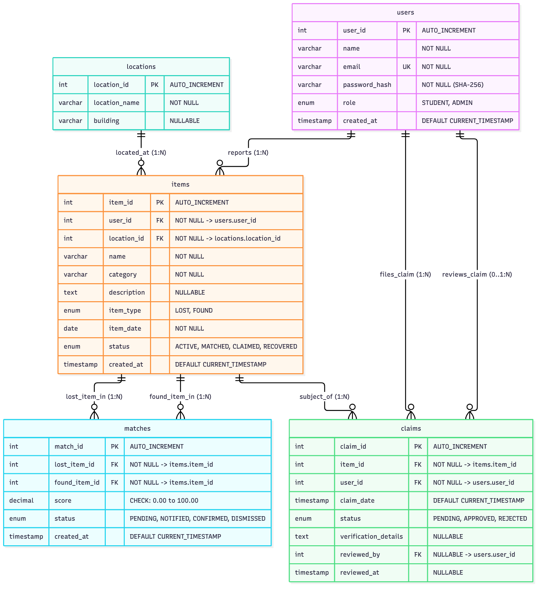

# Campus Lost & Found System

A desktop application for managing lost and found belongings across a university campus, built with **Java 26**, **JavaFX**, direct **JDBC**, and a local **MySQL** relational database.

Designed specifically for college project evaluation focusing on **Object-Oriented Programming (OOP)** and **Relational Database Management Systems (RDBMS)**.

---

## Table of Contents
1. [Project Overview](#project-overview)
2. [Problem Statement](#problem-statement)
3. [Objectives](#objectives)
4. [Features](#features)
5. [Technology Stack](#technology-stack)
6. [Project Architecture](#project-architecture)
7. [Project Directory Structure](#project-directory-structure)
8. [Demo Accounts and Login Credentials](#demo-accounts-and-login-credentials)
9. [OOP Concepts Demonstrated](#oop-concepts-demonstrated)
10. [Database Design & RDBMS Concepts](#database-design--rdbms-concepts)
11. [Data Structures & Algorithms (DSA) Summary](#data-structures--algorithms-dsa-summary)
12. [Database Setup](#database-setup)
13. [Database Configuration](#database-configuration)
14. [How to Launch the Application](#how-to-launch-the-application)
15. [How to Run Tests](#how-to-run-tests)
16. [Demonstration Instructions](#demonstration-instructions)
17. [System Limitations & Future Enhancements](#system-limitations--future-enhancements)

---

## Project Overview
The **Campus Lost & Found System** provides a centralized, secure digital portal for college campuses where students and faculty can report misplaced or discovered items, search through existing campus records, inspect automated similarity match recommendations, and submit ownership claims. Campus administrators can review claims through an atomic approval transaction, monitor recovery metrics, and audit real-time campus analytics.

---

## Problem Statement
On university campuses, thousands of valuable personal items (student ID cards, calculators, electronics, notebooks, keys, wallets) are misplaced every semester. Traditional physical lost-and-found desks or informal social media posts suffer from:
* **Fragmentation**: Information scattered across departmental noticeboards and disparate chat groups.
* **Lack of Verification**: Anyone can falsely claim an item without presenting identifying proof or details.
* **No Systematic Matching**: Lost reports and found reports are not automatically cross-referenced.
* **Data Loss & Inconsistency**: Lack of ACID transactional integrity causes double-claims or unrecorded handovers.

---

## Objectives
1. **Centralize Item Tracking**: Provide a single, unified database schema for all campus zones and facilities.
2. **Demonstrate Robust OOP**: Apply inheritance, polymorphism, encapsulation, abstraction, and custom exception handling across models and service layers.
3. **Ensure Relational Data Integrity**: Design normalized 3NF relational tables with strict foreign keys, unique constraints, check constraints, and indexed queries.
4. **Implement ACID Transactions**: Ensure claim approvals atomically transition claim and item states using row-level locking and rollback protection.
5. **Provide a Clean Desktop UI**: Build a responsive JavaFX GUI separated from business logic and database persistence.

---

## Features
* **Role-Based Authentication**: Secure login and self-service registration for Students and Administrators.
* **Item Reporting**: Report `LOST` or `FOUND` items with category, description, discovery date, and specific campus location.
* **Live Search & Filtering**: Multi-predicate in-memory search and database query filtering by keyword, category, location, and status.
* **Candidate Match Ranking**: Automated similarity scoring (0–100 scale) utilizing a binary max-heap `PriorityQueue`.
* **Ownership Claim Workflow**: Students submit verification details for discovered items; prevents self-claiming and duplicate claims.
* **Transactional Claim Review**: Admins approve or reject claims; approval atomically locks records (`FOR UPDATE`), sets claim to `APPROVED`, marks item as `RECOVERED`, confirms related matches, and rejects competing claims.
* **Administrative Analytics**: Real-time aggregated KPIs (total lost/found, recovery rates, active reports) and grouped location/category frequency tables.

---

## Technology Stack
* **Programming Language**: Java 26 (OpenJDK 26)
* **Build & Dependency Management**: Apache Maven 3.9+
* **User Interface**: OpenJFX (JavaFX 22.0.2)
* **Database Management System**: Local MySQL Server 8.0+ / 9.0+ (`campus_lost_found`)
* **Database Driver / Persistence**: JDBC (`com.mysql:mysql-connector-j:9.2.0`)
* **Unit & Integration Testing**: JUnit 5 (JUnit Jupiter 5.10.2)
* **Database Tooling**: MySQL Workbench / MySQL CLI

---

## Project Architecture

The application strictly enforces a **6-Layer Decoupled Architecture**:

```text
┌────────────────────────────────────────────────────────┐
│                      JavaFX UI                         │
│  (LoginView, RegisterView, StudentDashboard, Claims...) │
└───────────────────────────┬────────────────────────────┘
                            │ Method calls & view events
┌───────────────────────────▼────────────────────────────┐
│                    Service Layer                       │
│    (AuthService, ItemService, ClaimService, Analytics) │
└─────────────┬────────────────────────────┬─────────────┘
              │ In-memory ranking          │ Persistence
┌─────────────▼─────────────┐ ┌────────────▼─────────────┐
│    Business Logic / DSA   │ │        DAO Layer         │
│(ItemSearch, MatchAlgorithm│ │(UserDAO, ItemDAO,        │
│    MatchPriorityQueue)    │ │ ClaimDAO, AnalyticsDAO)  │
└───────────────────────────┘ └────────────┬─────────────┘
                                           │ SQL Statements
                              ┌────────────▼─────────────┐
                              │           JDBC           │
                              │(Connection, PreparedStatement)
                              └────────────┬─────────────┘
                                           │ TCP / Port 3306
                              ┌────────────▼─────────────┐
                              │    Local MySQL DBMS      │
                              │   (campus_lost_found)    │
                              └──────────────────────────┘
```

### Layer Responsibilities
1. **JavaFX UI (`com.campuslostfound.ui`)**: Manages GUI controls, input validation, and asynchronous events. Never contains SQL.
2. **Service Layer (`com.campuslostfound.service`)**: Enforces business rules, role authorization, and workflow orchestration.
3. **DSA Layer (`com.campuslostfound.dsa`)**: Performs in-memory keyword searching (`ItemSearch`), weighted similarity scoring (`MatchAlgorithm`), and priority ranking (`MatchPriorityQueue`).
4. **DAO Layer (`com.campuslostfound.dao`)**: Maps database rows to domain model objects and isolates SQL queries.
5. **JDBC (`java.sql.*`)**: Manages database connections, parameterized `PreparedStatement` executions, transactions, and result sets.
6. **MySQL DBMS**: Stores persistent data, enforces referential integrity, foreign key cascading rules, and check constraints.

---

## Project Directory Structure

```text
CampusLostFound/
├── pom.xml                               # Maven project configuration & dependencies
├── README.md                             # Project overview & documentation
├── .gitignore                            # Excludes target/, credentials, and IDE cache
├── database/
│   ├── schema.sql                        # DDL: Tables, constraints, and indexes
│   ├── seed.sql                          # DML: 5 Users, 7 Locations, 50 Items, 12 Matches, 7 Claims
│   └── queries.sql                       # DQL: Demonstration queries for viva evaluation
├── docs/
│   ├── DEMO_GUIDE.md                     # Step-by-step viva presentation guide
│   ├── VIVA_PREPARATION.md               # Comprehensive Q&A for OOP & RDBMS professors
│   ├── ERD.mmd                           # Editable Mermaid ER diagram source
│   └── ERD.png                           # Rendered high-resolution ER diagram
└── src/
    ├── main/
    │   ├── java/com/campuslostfound/
    │   │   ├── Main.java                 # Standard JVM entry point wrapper
    │   │   ├── MainApp.java              # JavaFX Application entry point
    │   │   ├── dao/                      # Data Access Objects (JDBC/SQL mapping)
    │   │   │   ├── AnalyticsDAO.java
    │   │   │   ├── ClaimDAO.java
    │   │   │   ├── ItemDAO.java
    │   │   │   ├── LocationDAO.java
    │   │   │   ├── MatchDAO.java
    │   │   │   └── UserDAO.java
    │   │   ├── database/                 # Connection management & credentials
    │   │   │   ├── DatabaseConfig.java
    │   │   │   └── DatabaseConnection.java
    │   │   ├── dsa/                      # Data structures & matching algorithms
    │   │   │   ├── ItemSearch.java
    │   │   │   ├── MatchAlgorithm.java
    │   │   │   └── MatchPriorityQueue.java
    │   │   ├── exception/                # Custom domain exceptions
    │   │   │   ├── CampusLostFoundException.java
    │   │   │   ├── InvalidClaimException.java
    │   │   │   ├── InvalidItemException.java
    │   │   │   └── InvalidMatchException.java
    │   │   ├── model/                    # Encapsulated entities & enums
    │   │   │   ├── Admin.java
    │   │   │   ├── AdminAnalytics.java
    │   │   │   ├── Claim.java
    │   │   │   ├── ClaimStatus.java
    │   │   │   ├── FoundItem.java
    │   │   │   ├── Item.java
    │   │   │   ├── ItemStatus.java
    │   │   │   ├── ItemType.java
    │   │   │   ├── Location.java
    │   │   │   ├── LostItem.java
    │   │   │   ├── Match.java
    │   │   │   ├── MatchStatus.java
    │   │   │   ├── User.java
    │   │   │   └── UserRole.java
    │   │   ├── service/                  # Business logic & transaction orchestration
    │   │   │   ├── AnalyticsService.java
    │   │   │   ├── AuthService.java
    │   │   │   ├── ClaimService.java
    │   │   │   ├── ItemService.java
    │   │   │   ├── MatchService.java
    │   │   │   └── SearchService.java
    │   │   └── ui/                       # JavaFX screens & dialog helpers
    │   │       ├── AdminDashboardView.java
    │   │       ├── AlertHelper.java
    │   │       ├── ClaimsView.java
    │   │       ├── LoginView.java
    │   │       ├── MatchesView.java
    │   │       ├── RegisterView.java
    │   │       ├── ReportItemView.java
    │   │       ├── SearchView.java
    │   │       ├── StudentDashboardView.java
    │   │       └── ViewNavigator.java
    │   └── resources/
    │       ├── app.css                   # Global JavaFX styling
    │       ├── db.properties.example     # Safe credential template for version control
    │       └── db.properties             # Local credentials (git-ignored)
    └── test/java/com/campuslostfound/
        ├── database/                     # JDBC CRUD integration tests
        ├── dsa/                          # Search, heap, and matching algorithm unit tests
        ├── model/                        # Model validation & exception edge case tests
        └── service/                      # Transactional approval & service unit tests
```

---

## Demo Accounts and Login Credentials

The local MySQL database contains pre-seeded student and administrator accounts.

### Seeded Demonstration Accounts

| User ID | Full Name | Email / Login ID | Role | Password | Primary Demonstration Use Case |
| :---: | :--- | :--- | :---: | :---: | :--- |
| **1** | Campus Administrator | `admin@campus.edu` | **ADMIN** | `DevPass@123` | Claim review, approval/rejection transactions, campus analytics dashboard |
| **2** | Alice Johnson | `alice@campus.edu` | **STUDENT** | `DevPass@123` | Reporting lost items, inspecting matches, filing claims on found items |
| **3** | Bob Smith | `bob@campus.edu` | **STUDENT** | `DevPass@123` | Reporting found items, viewing personal report history |
| **4** | Charlie Davis | `charlie@campus.edu` | **STUDENT** | `DevPass@123` | Lost ID card reports and multi-item searches |
| **5** | Diana Prince | `diana@campus.edu` | **STUDENT** | `DevPass@123` | Submitting secondary claims and testing validation limits |

> [!WARNING]
> **Security Notice**: These credentials are for the local college-project demonstration environment only. They are shared development accounts and must not be reused in production.

### Authentication & Password Storage Mechanism
* In `AuthService.java`, passwords are encrypted using standard **SHA-256** digests via Java's `java.security.MessageDigest`.
* The computed 64-character hexadecimal digest matches MySQL's native `SHA2(password, 256)` function used in `database/seed.sql`.
* Passwords are never stored in plaintext. In accordance with honest evaluation, the password hashing in this educational prototype is unsalted SHA-256; salted hashing (such as BCrypt or PBKDF2) is noted as a recommended future production enhancement.

### Login Instructions
1. **Student Login**: Enter `alice@campus.edu` and `DevPass@123`. The system loads the **Student Dashboard**, showing Alice's reported items, open claims, and quick links to report, search, and inspect candidate matches.
2. **Admin Login**: Enter `admin@campus.edu` and `DevPass@123`. The system redirects to the **Admin Dashboard**, displaying university-wide KPIs, top loss locations, top category charts, and the pending claims queue.

---

## OOP Concepts Demonstrated

The application demonstrates core Object-Oriented Programming principles:

### 1. Classes and Objects
* **Concept**: Blueprints and runtime instances modeling domain entities.
* **Demonstration**: [`Item`](file:///Users/t_s_8/Desktop/CampusLostFound/src/main/java/com/campuslostfound/model/Item.java), [`User`](file:///Users/t_s_8/Desktop/CampusLostFound/src/main/java/com/campuslostfound/model/User.java), [`Claim`](file:///Users/t_s_8/Desktop/CampusLostFound/src/main/java/com/campuslostfound/model/Claim.java), and [`Location`](file:///Users/t_s_8/Desktop/CampusLostFound/src/main/java/com/campuslostfound/model/Location.java).
* **Viva Note**: An object is an instantiated entity in heap memory with defined state (fields) and behavior (methods).

### 2. Encapsulation
* **Concept**: Hiding internal object state by making attributes `private` and exposing controlled access through getters and validated setters.
* **Demonstration**: In [`Item.java`](file:///Users/t_s_8/Desktop/CampusLostFound/src/main/java/com/campuslostfound/model/Item.java), `name`, `category`, and `itemDate` are private. Setter methods like `setName(String name)` validate that strings are non-empty and non-null before modifying the internal state, throwing `InvalidItemException` on illegal arguments.
* **Viva Note**: Protects object invariants and prevents external classes from corrupting data directly.

### 3. Inheritance
* **Concept**: Defining specialized child classes from a generalized base class to reuse common properties and declare specialized behavior.
* **Demonstration**:
  * Base class [`Item`](file:///Users/t_s_8/Desktop/CampusLostFound/src/main/java/com/campuslostfound/model/Item.java) is extended by [`LostItem`](file:///Users/t_s_8/Desktop/CampusLostFound/src/main/java/com/campuslostfound/model/LostItem.java) and [`FoundItem`](file:///Users/t_s_8/Desktop/CampusLostFound/src/main/java/com/campuslostfound/model/FoundItem.java).
  * Base class [`User`](file:///Users/t_s_8/Desktop/CampusLostFound/src/main/java/com/campuslostfound/model/User.java) is extended by [`Admin`](file:///Users/t_s_8/Desktop/CampusLostFound/src/main/java/com/campuslostfound/model/Admin.java), which adds administrative department tracking and privileges.
* **Viva Note**: Promotes code reuse and forms the structural basis for polymorphism.

### 4. Polymorphism
* **Concept**: Allowing child classes to provide custom implementations of parent methods (dynamic dispatch at runtime).
* **Demonstration**: In `Item.java`, the abstract methods `getDisplayDetails()` and `isClaimable()` are implemented differently:
  * `LostItem.isClaimable()` returns `false` (students cannot claim a lost report).
  * `FoundItem.isClaimable()` returns `true` if its status is `ACTIVE` or `MATCHED`.
  * `LostItem.getDisplayDetails()` formats `"LOST on <date>"`, while `FoundItem.getDisplayDetails()` formats `"FOUND on <date>"`.
* **Viva Note**: Callers can invoke `item.isClaimable()` on an `Item` reference without knowing whether it is a `LostItem` or `FoundItem` at compile time.

### 5. Abstraction
* **Concept**: Representing essential features while hiding complex low-level implementation details.
* **Demonstration**: [`Item`](file:///Users/t_s_8/Desktop/CampusLostFound/src/main/java/com/campuslostfound/model/Item.java) is an `abstract class` that cannot be instantiated directly. At the architectural level, the Service layer abstracts transaction handling and SQL away from the UI.

### 6. Constructors & Overloading
* **Concept**: Parameterized initialization of objects.
* **Demonstration**: `Item.java`, `User.java`, and `Claim.java` provide overloaded constructors—one for inserting new entities before the database generates an `auto_increment` ID, and one for reconstructing fully hydrated entities retrieved from JDBC `ResultSet`s.
* **Viva Note**: Method overloading demonstrates compile-time (static) polymorphism.

### 7. Custom Exception Hierarchy
* **Concept**: Domain-specific error reporting extending `RuntimeException`.
* **Demonstration**:
  * [`CampusLostFoundException`](file:///Users/t_s_8/Desktop/CampusLostFound/src/main/java/com/campuslostfound/exception/CampusLostFoundException.java) (base domain exception)
  * [`InvalidItemException`](file:///Users/t_s_8/Desktop/CampusLostFound/src/main/java/com/campuslostfound/exception/InvalidItemException.java)
  * [`InvalidClaimException`](file:///Users/t_s_8/Desktop/CampusLostFound/src/main/java/com/campuslostfound/exception/InvalidClaimException.java)
  * [`InvalidMatchException`](file:///Users/t_s_8/Desktop/CampusLostFound/src/main/java/com/campuslostfound/exception/InvalidMatchException.java)
* **Viva Note**: Low-level `SQLException`s are caught in the DAO/Service layers, logged, and wrapped in descriptive domain exceptions before reaching the UI.

---

## Database Design & RDBMS Concepts

The database `campus_lost_found` is organized into 5 relational tables designed in Third Normal Form (3NF).

### Entity-Relationship Diagram (ERD)



*(Mermaid source is maintained in [`docs/ERD.mmd`](file:///Users/t_s_8/Desktop/CampusLostFound/docs/ERD.mmd)).*

### Database Tables & Schema Overview

| Table | Purpose | Primary Key | Foreign Keys | Key Constraints |
| :--- | :--- | :--- | :--- | :--- |
| **`users`** | Stores student and admin credentials & roles | `user_id` (INT AI) | None | `email` UNIQUE, `role` ENUM |
| **`locations`** | Physical campus locations and buildings | `location_id` (INT AI) | None | UNIQUE(`location_name`, `building`) |
| **`items`** | Central repository for LOST and FOUND reports | `item_id` (INT AI) | `user_id` → `users`<br>`location_id` → `locations` | `item_type` ENUM, `status` ENUM, ON DELETE RESTRICT |
| **`matches`** | Similarity candidate pairs generated by algorithm | `match_id` (INT AI) | `lost_item_id` → `items`<br>`found_item_id` → `items` | UNIQUE(`lost_item_id`, `found_item_id`), CHECK(`score` BETWEEN 0 AND 100), ON DELETE CASCADE |
| **`claims`** | Ownership verification requests filed by students | `claim_id` (INT AI) | `item_id` → `items`<br>`user_id` → `users`<br>`reviewed_by` → `users` | `status` ENUM, ON DELETE CASCADE (`items`), ON DELETE SET NULL (`reviewed_by`) |

### Normalization Justification (1NF, 2NF, 3NF)
* **First Normal Form (1NF)**: Every table has a primary key; each column contains atomic (indivisible) scalar values; no multi-valued attributes or repeating groups.
* **Second Normal Form (2NF)**: All tables are in 1NF and all non-key attributes are fully functionally dependent on the entire primary key. No partial dependencies exist because all primary keys are single-column synthetic keys (`AUTO_INCREMENT`).
* **Third Normal Form (3NF)**: All tables are in 2NF and contain no transitive dependencies (no non-prime attribute depends on another non-prime attribute). Campus buildings are normalized into `locations` rather than repeated in `items`, eliminating:
  * **Insertion Anomalies**: New campus locations can be created even if no items have been lost there yet.
  * **Deletion Anomalies**: Deleting an item report does not purge campus location details.
  * **Update Anomalies**: Changing a building name requires updating exactly one row in `locations`.

### ACID Transactions (Claim Approval Process)
In [`ClaimDAO.approveClaimTransaction`](file:///Users/t_s_8/Desktop/CampusLostFound/src/main/java/com/campuslostfound/dao/ClaimDAO.java#L186-L295):
1. **Atomicity**: The approval modifies multiple tables (updates `claims` to `APPROVED`, updates `items` to `RECOVERED`, updates `matches` to `CONFIRMED`, and rejects competing pending claims). If any query fails, `conn.rollback()` restores the initial state completely.
2. **Consistency**: The database transitions only between valid states defined by foreign keys, check constraints, and item status rules.
3. **Isolation**: Uses `conn.setAutoCommit(false)` and acquires pessimistic write locks using `SELECT ... FOR UPDATE` on both the target claim and the target item, preventing concurrent approvals or race conditions.
4. **Durability**: Once `conn.commit()` succeeds, the changes are permanently written to MySQL's transactional InnoDB redo logs.

---

## Data Structures & Algorithms (DSA) Summary

*(DSA is kept concise and focused strictly on implemented code).*

1. **`ArrayList<Item>`**: Dynamic resizing collection used for storing retrieved item reports and executing filtering pipelines.
2. **`HashMap<Integer, Item>`**: In-memory hash table providing average $O(1)$ constant-time lookup by item ID.
3. **`PriorityQueue<Match>` (`MatchPriorityQueue`)**: Binary Max-Heap ranking candidate item matches. Time complexities:
   * Insert (`offer`): $O(\log N)$ via heap sift-up.
   * Remove highest match (`poll`): $O(\log N)$ via heap sift-down.
   * Inspect top candidate (`peek`): $O(1)$.
   * Deterministic tie-breaking comparator: Score (descending) $\rightarrow$ Date created (descending) $\rightarrow$ Match ID (ascending).
4. **`MatchAlgorithm` (Weighted Similarity Scoring)**: Evaluates candidate lost/found pairs on a 0–100 scale:
   * **Category Match**: 25 points (exact case-insensitive match).
   * **Location Match**: 25 points (identical campus location ID).
   * **Date Proximity**: 20 points (scaled by day differential: same day = 20, $\le 3$ days = 15, $\le 7$ days = 10, $\le 14$ days = 5).
   * **Name Similarity**: 20 points (word-level Jaccard token overlap).
   * **Description Similarity**: 10 points (word-level token overlap).
   * **Threshold**: $\ge 70.0$ points qualifies as a candidate match.

---

## Database Setup

### Step 1: Open MySQL Workbench or Terminal
Log in to your local MySQL server:
```bash
mysql -u root -p
```

### Step 2: Create Schema
Execute the schema script to create the database and tables:
```bash
mysql -u root -p < database/schema.sql
```
*(Or open `database/schema.sql` in MySQL Workbench and execute all statements).*

### Step 3: Populate Seed Records
Execute the seed script to load initial demo users, campus locations, 50 item reports, matches, and claims:
```bash
mysql -u root -p < database/seed.sql
```

> [!NOTE]
> `database/seed.sql` safely truncates tables before inserting to ensure a clean state. Do not execute it during a live viva demonstration as it will reset items created during the session.

---

## Database Configuration

Credentials are managed through `src/main/resources/db.properties`.

1. Copy the example configuration:
   ```bash
   cp src/main/resources/db.properties.example src/main/resources/db.properties
   ```
2. Edit `src/main/resources/db.properties` with your local MySQL password:
   ```properties
   db.url=jdbc:mysql://localhost:3306/campus_lost_found?useSSL=false&allowPublicKeyRetrieval=true&serverTimezone=UTC
   db.user=root
   db.password=your_mysql_password
   ```
3. **Security Assurance**: `src/main/resources/db.properties` is strictly registered in `.gitignore` to prevent credential leakage.
4. **Environment Variables Fallback**: If `db.properties` is omitted, [`DatabaseConfig`](file:///Users/t_s_8/Desktop/CampusLostFound/src/main/java/com/campuslostfound/database/DatabaseConfig.java) automatically falls back to `DB_URL`, `DB_USER`, and `DB_PASSWORD` environment variables.

---

## How to Launch the Application

### Option 1: Via Maven JavaFX Plugin (Recommended)
Run directly from terminal in the project root:
```bash
mvn javafx:run
```

### Option 2: Build Executable JAR
```bash
mvn clean package
java -jar target/CampusLostFound-1.0.0-SNAPSHOT.jar
```

### Note on `Main.java` vs `MainApp.java`
* `pom.xml` configures `com.campuslostfound.MainApp` as the main class for `javafx-maven-plugin`.
* [`MainApp.java`](file:///Users/t_s_8/Desktop/CampusLostFound/src/main/java/com/campuslostfound/MainApp.java) extends `javafx.application.Application` and initializes the primary stage.
* [`Main.java`](file:///Users/t_s_8/Desktop/CampusLostFound/src/main/java/com/campuslostfound/Main.java) is a lightweight wrapper with a plain `public static void main` method that delegates to `MainApp.main(args)`. In Java 11+, this indirection prevents JVM runtime errors (`"JavaFX runtime components are missing"`) when launching packaged JAR files outside a module path.

---

## How to Run Tests

Execute the full automated test suite via Maven:
```bash
mvn clean test
```

### Verified Test Results (Reported from Clean Execution)
```text
Results:
Tests run: 92, Failures: 0, Errors: 0, Skipped: 0
BUILD SUCCESS
```

The test suite covers:
* **Unit Tests**:
  * Domain model encapsulation and polymorphic behavior ([`ModelTest`](file:///Users/t_s_8/Desktop/CampusLostFound/src/test/java/com/campuslostfound/model/ModelTest.java)).
  * In-memory search and multi-predicate filtering ([`ItemSearchTest`](file:///Users/t_s_8/Desktop/CampusLostFound/src/test/java/com/campuslostfound/dsa/ItemSearchTest.java)).
  * Weighted matching algorithm logic ([`MatchAlgorithmTest`](file:///Users/t_s_8/Desktop/CampusLostFound/src/test/java/com/campuslostfound/dsa/MatchAlgorithmTest.java)).
  * Binary max-heap priority queue ordering ([`MatchPriorityQueueTest`](file:///Users/t_s_8/Desktop/CampusLostFound/src/test/java/com/campuslostfound/dsa/MatchPriorityQueueTest.java)).
  * Service layer validation rules ([`AuthServiceTest`](file:///Users/t_s_8/Desktop/CampusLostFound/src/test/java/com/campuslostfound/service/AuthServiceTest.java), [`ItemServiceTest`](file:///Users/t_s_8/Desktop/CampusLostFound/src/test/java/com/campuslostfound/service/ItemServiceTest.java), [`ClaimServiceTest`](file:///Users/t_s_8/Desktop/CampusLostFound/src/test/java/com/campuslostfound/service/ClaimServiceTest.java)).
* **Integration Tests**:
  * Real database connectivity and schema verification ([`DatabaseIntegrationTest`](file:///Users/t_s_8/Desktop/CampusLostFound/src/test/java/com/campuslostfound/database/DatabaseIntegrationTest.java)).
  * Full DAO CRUD operations using `PreparedStatement` ([`DaoCrudIntegrationTest`](file:///Users/t_s_8/Desktop/CampusLostFound/src/test/java/com/campuslostfound/database/DaoCrudIntegrationTest.java)).
  * Real multi-table ACID transaction commit and rollback verification ([`ClaimTransactionIntegrationTest`](file:///Users/t_s_8/Desktop/CampusLostFound/src/test/java/com/campuslostfound/service/ClaimTransactionIntegrationTest.java)).
  * SQL injection resistance and concurrency edge cases ([`SecurityAndEdgeCasesIntegrationTest`](file:///Users/t_s_8/Desktop/CampusLostFound/src/test/java/com/campuslostfound/service/SecurityAndEdgeCasesIntegrationTest.java)).

---

## Demonstration Instructions

For a structured live presentation to OOP and RDBMS evaluators:
1. **Open Visual Studio Code / IDE**: Walk through `Item.java`, `LostItem.java`, and `FoundItem.java` to highlight inheritance and polymorphism.
2. **Open MySQL Workbench**: Display the 5 normalized tables in `campus_lost_found` and show the generated ER diagram ([`docs/ERD.png`](file:///Users/t_s_8/Desktop/CampusLostFound/docs/ERD.png)).
3. **Launch the Application**: Run `mvn javafx:run`.
4. **Student Workflow**:
   * Log in as `alice@campus.edu` / `DevPass@123`.
   * Report a newly found item (e.g. "Scientific Calculator").
   * Navigate to the **Matches** screen to show calculated similarity ranking.
   * Submit an ownership claim with verification details.
5. **Admin Workflow**:
   * Log out and log in as `admin@campus.edu` / `DevPass@123`.
   * View the pending claims queue.
   * Approve a claim and show the success message.
6. **SQL Database Verification**:
   * Run queries in MySQL Workbench proving that the claim transitioned to `APPROVED` and the item transitioned to `RECOVERED`.
   * Show live aggregated metrics in the Admin Dashboard.

*Refer to [`docs/DEMO_GUIDE.md`](file:///Users/t_s_8/Desktop/CampusLostFound/docs/DEMO_GUIDE.md) for detailed step-by-step presentation scripts and SQL verification queries.*

---

## System Limitations & Future Enhancements

In accordance with academic rigor, implemented features are distinguished from technical limitations:

### Current Limitations
1. **Local Desktop Architecture**: The application is built as a JavaFX desktop client requiring local database access, rather than a cloud-hosted web application.
2. **Unsalted SHA-256 Hashes**: Password hashing uses unsalted SHA-256 for direct compatibility with MySQL's `SHA2()` seed functions.
3. **No Image Uploads**: Item reports store rich text descriptions and location details, but do not store binary photo attachments in MySQL blobs or object storage.
4. **Local Network Scope**: Intended for a single campus deployment sharing a central MySQL database instance.

### Future Enhancements
* **BCrypt Password Hashing**: Upgrade password hashing to salted BCrypt with adaptive work factors.
* **Photo Attachments**: Integrate image capture and secure local/cloud object storage.
* **Email & Push Notifications**: Integrate JavaMail API to alert students when a candidate match score exceeds 85.0 points.
* **REST API & Mobile Client**: Decouple the service layer behind Spring Boot REST endpoints to support an Android or web frontend.
